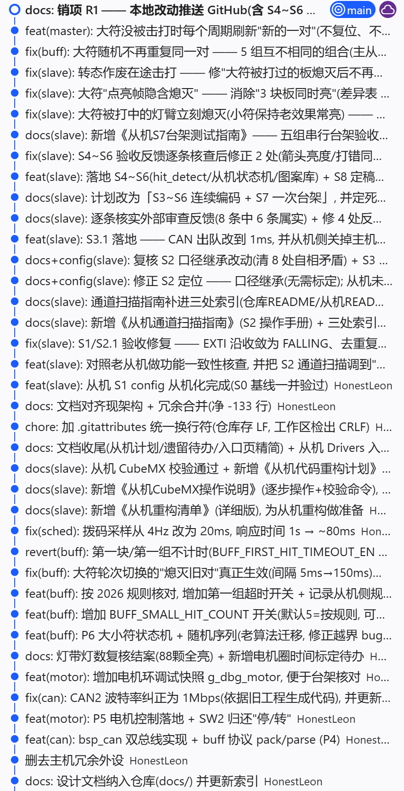

# 重构工作记录 —— 2027 能量机关（大符/小符）固件

对象是 `2025_Embedded-Buff/` 那套老固件（master + slave），重构后是仓库里的 `2027_Embedded_Buff/`。
平台 STM32F405RGT6 + HAL，Keil MDK-ARM，CubeMX 6.15；主从共用同一块 PCB，分两个工程构建。

先说清一件事：老代码的灯珠驱动思路是对的——用"PWM 周期 = 1 个 bit、DMA 逐 bit 灌 CCR"驱动
WS2812，这套东西原样搬了过来，一个字节都没改思路。要动的是它外围的东西。逐条明细的出处都在
`docs/` 里，见文末索引。

---

## 一、为什么要重构

### 1.1 结构上的问题

| 问题 | 老代码里的样子 | 造成的后果 |
|---|---|---|
| 一个 `main.c` 干所有事 | 老主机 `main.c` 809 行里同时有 CAN 收帧解析、大小符状态机、灯珠寄存器操作、EXTI 回调、电机 PID | 改任一模块要通读全文件；出问题说不清是谁改了谁 |
| 配置散落，主从各说各话 | 灯数、引脚、超时、规则魔数写在 `main.c` 和 CubeMX 注释里；同一通道主从灯数都不一样（`PA6` 主机 88 / 从机 87，`PB1` 主机 256 / 从机 320） | 换板或改线要全文件搜数字；两版固件驱动的根本不是同一批灯带，从代码上看不出来 |
| 拷贝残留 | 主机工程从从机工程拷来裁剪：定义 4 个灯带数组、启动 4 路 DMA，但主机板上实测只接了 1 条，而且 `main.c` 从没调用过任何图案函数 | 白占约 38KB RAM（128KB 的片子）；数组注释和实物对不上，排查被带偏 |
| 隐式标志当状态机用 | `once`、`start`、`test_flag`、`counter`、`first_hit_flag` 互相耦合，状态含义靠上下文推断 | 打错、超时、轮次切换三条路径互相覆盖，改一处崩三处 |
| 阻塞式写法 | 主循环里 `HAL_Delay(200)`；CAN 发送 `while` 死等空邮箱；CAN 接收是单缓冲，后帧覆盖前帧 | 一次阻塞就是 200ms 事件积压；CAN2 掉线时死等邮箱直接卡死 |
| 协议裸字节 | `0x161`/`0x160` 的字段用魔数下标散落读写；从机上报"打错"只写 `[0]`、`[2]`，`[1]` 残留上一次的 `0x03`；没有包头和范围校验 | 总线上一帧坏数据就能让主机推进错轮次；协议改动要在两个工程里逐处搜 |
| 随机数依赖 TIM2 | `srand(CNT_my)`，靠 TIM2 5Hz 中断喂 `random_seed` | 新架构删掉 TIM2 后 `CNT_my` 无人递增，随机流退化甚至每局重复 |
| 驱动位序反了 | 老 `WS2812.c` 按 LSB-first 移位，而灯珠要求 MSB-first | 亮度定值 `10` 实际打到灯珠是 `80`，所有亮度值都是歪打正着；换正确驱动就暗 8 倍 |
| 数组越界读 | 老主机 `num[counter]` 在 `counter==5` 时越界读到相邻数组首元素 | 小符实际要打 6 次（规则是 5 次），行为还依赖链接顺序 |
| 板号靠改宏，没有护栏 | 老从机 `#define BUFF_NUM 3`，改宏重编译，无越界检查，输出固件名不带板号 | 5 块板共用一个工程，烧错板号等于打符流程错乱，现场极难发现 |

### 1.2 赛场上真实暴露的缺陷

四个老 bug 的编号沿用《代码重构计划》第 10 行的定义：

| 编号 | 现象 | 根因 |
|---|---|---|
| ① | 拨码切红蓝，灯不跟着变，只在上电刷那一次 | 灯色只在初始化路径写，业务循环里没有"变化即刷新" |
| ② | 跑着跑着花屏、串色，是 R 标颜色异常的病根 | 每圈无条件重启 5 路 DMA，撞上上一帧还没传完的 DMA |
| ③ | 灯带末端残点、整条偶发错乱 | 复位段裕量不足：老驱动 `WS2812_Reset_NUM=50` bit ≈62.5µs，只勉强过 50µs 规格 |
| ④ | 先改拨码再上电，中心灯带色序会异常 | 拨码采样与灯带初始化的先后没有约束。回归验证仍挂在待办 M2，还没做 |

另外三条同样是在台架和赛场上撞出来的：

- 大符轮次切换时旧灯板不熄灭。主机"熄灭旧对→点亮新对"老代码只隔约 1ms，而老从机是 200ms
  主循环加 CAN 单缓冲，只看得到后一帧，熄灭帧被吞。这是老从机的固有缺陷，不改进度就修不掉。
- 碰一下电极有时被判成"打错"，整局复位。EXTI 配的是双边沿，没有消抖窗，表外引脚也参与判定。
- 中部灯臂的进度 n/5 从来没实现过，而规则 5.5.2.1 要求它。两边各有一半责任：从机收到
  `[6]=round` 但不渲染，老主机发出的 `[6]` 本来也是靠上一帧残留。

还有一条不算 bug 但很致命：没有任何观测手段。查问题只能加打印、抱逻辑分析仪上台架。

---

## 二、重构后好在哪里

### 2.1 架构上的变化

| 维度 | 老代码 | 新代码 |
|---|---|---|
| 分层 | `main.c` + `Divice/WS2812.c` 两层混写 | `Core/`（CubeMX 生成，只动 USER CODE）、`config/`（只放宏和 const 表）、`bsp/`（硬件与中断收尾）、`application/`（业务），依赖只准向下。文件按外设命名，某个外设出问题，`config_<外设>.h` → `bsp_<外设>.c` → `application/<模块>.c` 三点一线查完 |
| 调度 | 主循环 + `HAL_Delay`，TIM2/TIM4 混用 | TIM6 的 1ms 中断是唯一调度器：1ms 排空 CAN 并给状态机计时，20ms 采拨码（连续 4 次一致才生效，约 80ms），250 分频的 4Hz 逻辑帧跑图案和上报消费，主循环空转。全工程不许有阻塞延时 |
| 灯带驱动 | 思路正确，但每圈全刷、位序反 | 只有内容变化的那条灯带才启 DMA（dirty/busy 握手），每 tick 最多启动 2 条以保护中断耗时，未接灯带的通道 `led_num=0` 不分配缓冲（主机侧因此腾出约 38KB），位序改回 MSB-first |
| 协议 | 裸字节散落读写 | `buff_frame_pack/parse` 单点收口，校验包头 `0xAA`、命令范围、板号范围。主从两份 `buff.c` 的协议段要求逐字节一致，可以 diff 校验，改动必须两边同步 |
| 状态机 | `once`/`start`/`flag` 隐式标志 | 显式枚举：主机 `bb_state_t`、从机 `slv_state_t`、击打 `hd_st_t`；状态转换收敛到唯一入口 `go()` 和 `slv_enter()` |
| 从机实时性 | 200ms 主循环 + CAN 单缓冲 | 1ms 排空 CAN，并逐帧锁存"与本板有关"的命令，1ms 就换态，4Hz 才消费击打事件。这样 150ms 的"先熄后亮"两帧不会被塌缩成一帧 |
| 观测 | 加打印 | 一整套能 Watch 的快照：`g_dbg_slv`、`g_dbg_hit`、`g_dbg_pat`、`g_dbg_buff_*`、`g_dbg_motor`、`g_buff_rx`，外加 CAN 收发丢帧计数和 `age_ms`、`max_burst`、`imp_off`、`stale_hit` 这些能当硬证据的计数器。台架方法因此定死为"实机观察 + Watch"，不需要 CAN 分析仪 |
| 规则参数 | 写死在代码里 | 做成开关：`BUFF_SMALL_HIT_COUNT`（5 按规则，6 复刻老固件的越界行为）、`BUFF_FIRST_HIT_TIMEOUT_EN`、`BUFF_EXTINGUISH_GAP_MS`（150，规则上限 200）、`SLV_IMPLICIT_OFF_EN`、`HD_IGNORE_MS`、`BUFF_BIG_REFRESH_EN`。赛前裁判有异议，改一行重编译 |
| 板号 | 改宏，无检查 | `SLAVE_PANEL_NUM` 越界直接编译不过，输出固件文件名带板号，烧录纪律写进《从机S7台架测试指南》0.2 |
| 文档 | 一份手记 `大符思路.txt` | `docs/` 14 份：两条阶段路线图、逐项清单、老新逐行对照、CubeMX 配置依据、两份自检排障指南、一份 S7 台架验收指南、一份待办总览（完成即销项） |

### 2.2 解决掉的问题

| 问题 | 修法 | 拿什么判断修好了 |
|---|---|---|
| 老 bug①：拨码变色不即时 | `light_tick()` 每逻辑帧比对拨码并刷新 | 主机 P3 逐路白光 + 拨码切换（台架记录表待回填） |
| 老 bug②：每圈重启 DMA 导致花屏 | dirty/busy 握手，只刷变化过的条，每 tick 最多 2 条 | 连续 30min / 2h 无花屏 |
| 老 bug③：复位段裕量不足 | 复位段从 50 bit ≈62.5µs 加到 90 bit ≈112µs（差异表 #15，有意加强） | 逻辑分析仪：bit 1.25µs、T0H≈357ns、T1H≈893ns、复位段≈112µs |
| 老从机吞熄灭帧 | 主机间隔改 150ms；从机 1ms 排空 + 逐帧锁存；再加"点亮帧隐含熄灭"兜底（差异 #21） | `g_buff_rx.imp_off` 恒 0 说明一帧没丢；大于 0 说明丢过但已自愈 |
| 3 块板同时亮（大符，台架实测） | 差异 #21：大符的点亮帧就是"本轮该亮的集合"，不在集合里的板收敛到休眠 | 轮次切换后全场只有 2 块亮 |
| 大符打中的灯臂不熄灭，看不出这块已经打完 | 差异 #20：`light_set_big()` 按模式分叉，大符打中后灯臂保持熄灭，小符仍复刻老效果常亮 | `g_dbg_pat.big` |
| 被打过的板熄灭后一直不亮，主机还老是整体复位 | 差异 #22：EXTI 在 1ms 采、4Hz 才判定，最长跨 250ms，期间主机的熄灭帧已经把状态打回去了。改成转态即 `hit_detect_flush()` 作废在途击打，消费前再校验一次 `state==ARMED` | `g_dbg_slv.stale_hit`；`report_mishit` 只在真打错时才涨 |
| 抖动误判打错 | EXTI 沿收敛成 FALLING（`.ioc` 10 处 + `gpio.c` 2 处），加 `HD_IGNORE_MS=100ms` 窗，表外引脚只计数不判定 | `g_dbg_hit.ignored` 增长、`stray` 恒 0 |
| 随机数每局可能重复 | 删掉 TIM2，上电用硬件 RNG 注一次种子 | — |
| 大符随机到同一对点两遍 | M8：`buff_random_big()` 改成从 C(5,2)=10 种组合里无重复抽组（部分 Fisher–Yates）。老算法在主机侧跑 20 万局实测，相邻两轮同对 10.0%，一局平均重复 0.91 次 | 同一份建模：同对 0 次，10 种组合分布偏差 ±0.5% |
| 大符一直没被击打就不刷新 | M9：每 2.5s 没打中就把这一对熄灭、点亮新一对，不推进进度也不复位。大符的序列结构随之从"预生成 5 组"改成"10 个组合逐个领用"，本局点过的每一对都不重样 | `g_dbg_buff_refresh` 递增而 `g_dbg_buff_round` 不变 |
| 小符击打次数越界（实际 6 次） | 默认按规则 5 次；`BUFF_SMALL_HIT_COUNT=6` 可显式复刻老行为，越界读换成有定义的行为 | — |
| CAN2 掉线死等邮箱 | 发送查一次空邮箱、满了就丢，配 `bsp_can1/2_tx_drop_count()`；接收双队列加溢出计数 | 断线时 drop 计数增长但系统不死机 |
| 空通道白占 RAM | 未接灯带的 5 个通道 `led_num=0`，不分配缓冲也不发送 | map 文件核对，腾出约 38KB |

### 2.3 新增的能力

灯带逐条白光自检。把 `DEBUG_TEST_MODE` 置 1 编一份调试固件，上电就逐条点亮，只遍历本机
实接的条，配合 `g_dbg_ws_scan_idx` 直接读出"现在亮的是哪条通道"。主机靠它定位出中心灯带是
索引 0 / TIM3_CH1 / PA6 / 88 颗，顺带纠正了板上丝印和固件口径的错位（丝印 DIN2 标着"中心圆环"，
实际是 PB6 一个空置口）。

大符的组合不重复与周期刷新，就是 M8 和 M9，本轮加的。

从机的状态机和灯板图案库（S4~S6）。待激活是 19 段靶面加箭头流动，已激活按环数查表点亮段位
（含 1 环亮六段的特例），全激活填上下两条灯带。所有标定表与老从机逐条核对后继承，硬件与
2025 相同，没有重新标定。

`[6]=round` 这条链路已经打通：主机每帧带真实轮次，从机镜像进 `g_dbg_slv.round`。但中部灯臂
n/5 的渲染还没做，排在 S8 专项，要等 S7 台架全绿。

一套台架方法学：《从机S7台架测试指南》把验收拆成五组串行（收帧链路、击打环数、状态机全流程、
图案与亮度、五板联机与烤机），每组给步骤、判据表、记录表、通过判据，最后附一张"看到什么现象
先看哪个变量"的故障树。

### 2.4 代码量是涨了的

业务层（`config` + `bsp` + `application`）的行数：老主机约 1059 行（`main.c` 809 +
`WS2812.c` 250），新主机 1905 行，新从机 2544 行。多出来的部分是配置表、协议校验、显式状态、
诊断结构体，以及解释"为什么这样写"的注释。换来的是：老代码出问题要把 809 行的 `main.c`
通读一遍去猜，现在先看一个 `g_dbg_*` 结构体，多数情况能直接指到哪个模块的哪一拍。

---

## 三、结果展示

### 3.1 Git 提交树

从 P0 分层骨架到当前 HEAD 共 40 个提交（`e73c3b7` → `da98579`，2026-10-17 推送）：

### 3.2 仓库

<https://github.com/HonestLeon/2027_Embedded_Buff>，分支 `main`，公开仓库。两个工程分别是
`2027_Embedded_Buff_Master/`（主机、中心板）和 `2027_Embedded_Buff_Slave/`（从机、打符灯板）。
文档随仓库版本化，入口在根目录 `README.md` 的文档表。

### 3.3 台架实测视频

GitHub 的 Markdown 会过滤 `<video>` 标签，仓库里的 mp4 没法内嵌播放，所以这里只给文件位置，
不做播放器。两个文件都在 `docs/` 下，本地双击即播：`小符测试视频.mp4`（2.8MB，点亮、击打、
逐块推进到全亮）和 `大符测试视频.mp4`（6.1MB，一对点亮、击打、熄灭旧对、点亮新对）。
要在 GitHub 上在线看，得挂到 Release 的 Assets 或某个 Issue 的附件里，那里支持 mp4 播放，
再把链接换回本节。

### 3.4 完成度

| 部分 | 状态 |
|---|---|
| 主机 P0~P6：分层、灯带驱动、CAN 双总线、电机环、大小符状态机与随机 | 完成，与旧从机对接测试已通过 |
| 从机 S0~S6：CubeMX 校验、config 从机化、灯带 6 通道口径、1ms 收帧、击打检测、状态机、图案库 | 代码完成，台架实测修掉 #20/#21/#22 |
| 从机 S7：五组台架验收（环数映射、⑦确熄专测、亮度定值 10/80、联机、烤机） | 进行中，按指南逐组记录 |
| 主机 P7 收尾：M1 电机圈时间标定、M2 上电色序回归、M3 两小时烤机 | 未做 |
| 从机 SL5：RDET9 环数映射核对，老代码记的是 1 环，疑为笔误 | 高优先，S7 组 2 定案 |
| S8：中部灯臂进度 n/5，规则要求而老从机从未实现 | 待 S7 全绿后开做 |

---

## 附：想查细节去哪份文档

| 想查什么 | 看哪份 |
|---|---|
| 为什么这么分层、调度怎么跑、模块职责 | `代码架构设计.md` |
| 老代码逐行分析、哪些值是原样继承的 | `重构对照-旧代码与新设计.md` |
| 主机按什么顺序做了什么 | `代码重构计划.md`（P0~P7） |
| 从机做了什么、还剩什么 | `从机代码重构计划.md`（S0~S8）、`从机重构清单.md`（逐项明细与 22 条差异） |
| CubeMX 每一项配置的依据 | `主机CubeMX配置清单.md`、`从机CubeMX操作说明.md`、`CubeMX裁剪说明.md` |
| 灯带不亮、通道对不上怎么查 | `白光测试指南.md`（主机）、`从机灯带自检与排障.md`、`P3调试指南.md` |
| 上台架怎么测、判据是什么 | `从机S7台架测试指南.md` |
| 还没做完的、在等谁确认 | `遗留待办与开放问题.md` |
| 2025 赛季的原始需求手记 | `大符思路.txt` |
